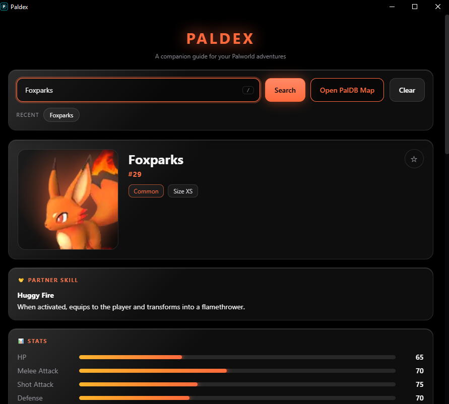

# Paldex

A dark, glass-style desktop companion for **Palworld**. Search any Pal and see its stats, partner skill, elements, work suitability, notable drops, alpha locations, eggs and habitat, with a pannable map showing where it lives.



## Features

- Search across all Pals with suggestions as you type (press `/` to jump to the search box)
- Stat bars, partner skill, colour-coded elements, work suitability pips and drop icons
- Interface colours follow the Pal's element
- Habitat map of the Palpagos Islands: drag, zoom, and pins for each habitat region
- Recent searches and favourites that are remembered between sessions
- One-click **Open PalDB Map** to open the Pal's page on PalDB in your browser
- Image cache, so repeat searches are instant

## Built with

- Python 3
- [PySide6](https://doc.qt.io/qtforpython-6/) (Qt for Python): the window and the web view
- HTML, CSS and JavaScript for the interface (`web/index.html`), connected to Python with Qt WebChannel
- `requests` for downloading images

## How it works

The window shows a web page. When you search, the page asks Python for the Pal, and Python answers with a dictionary of its data (built from the JSON and CSV files in this folder). Python also downloads and caches the Pal's images. See `SESSION_claude_glass_ui_and_map.md` for the full walkthrough.

## Run it

```bash
git clone https://github.com/<your-username>/Paldex.git
cd Paldex
python -m venv .venv
.venv\Scripts\activate        # Windows
pip install -r requirements.txt
python main.py
```

`main_classic.py` is the earlier widget-based interface and runs the same way.

## Build a Windows .exe (optional)

```bash
pip install pyinstaller
pyinstaller Paldex.spec
```

The finished app appears in the `dist` folder.

## Known limits

- The World Tree map has its own coordinate range that is not calibrated yet, so its spots are listed as text instead of pinned.
- Habitat pins mark a representative point for each habitat region, not exact spawn spots.

## Notes

This is an unofficial fan project and is not affiliated with or endorsed by Pocketpair, Inc. Pal data and images come from [PalDB](https://paldb.cc/). The map pictures are textures from the game.
